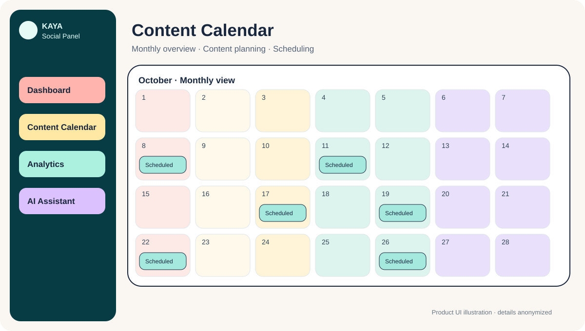
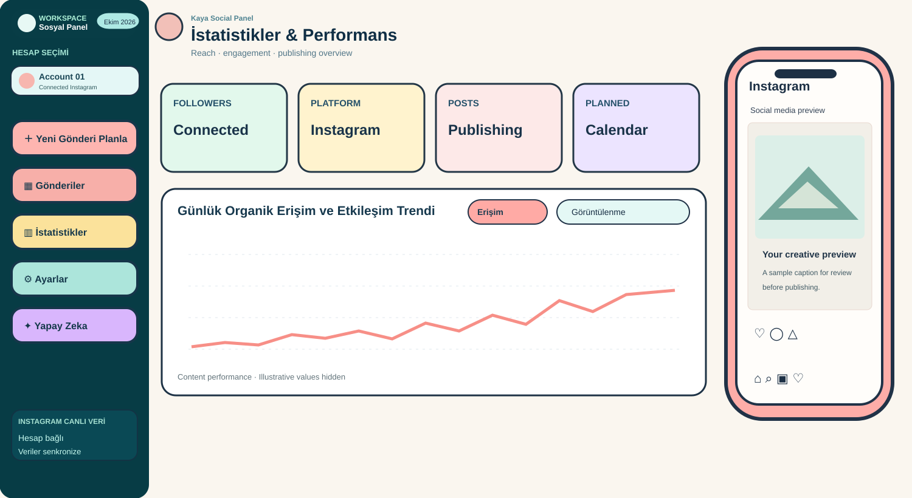
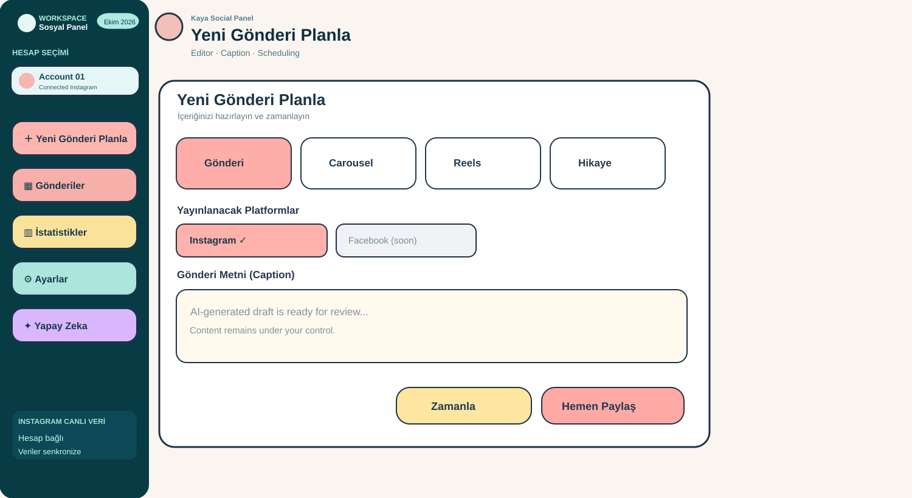

<div align="center">

# Kaya Social Panel
### AI-assisted social media management, with people in control.

**Plan deliberately. Create efficiently. Review confidently.**

*A private, independently developed software product.*

</div>

---

## Overview

Kaya Social Panel brings content preparation, visual review, scheduling, and performance monitoring into a single social media workspace. It connects AI-assisted content creation with a deliberate, approval-led publishing process.

It was developed around a practical need: reduce the operational friction of preparing and managing social media content, without giving up editorial control.

> **Product showcase only.** This is not an open-source repository or a software download. The implementation, credentials, integrations, internal prompts, and proprietary workflows remain private.

## Interface gallery

The visuals below are **privacy-safe illustrations based on the real product interface**, not unedited screenshots. Personal account details, real analytics, and private publishing content have been replaced with illustrative elements.

### Content calendar



### Analytics and reporting



### AI-assisted publishing and preview



## At a glance

| Area | Product experience |
| --- | --- |
| **Content calendar** | Monthly and weekly planning views, with post cards and scheduled content |
| **Multiple accounts** | Select a connected account when preparing a publication |
| **Content formats** | Editor options for single-image posts, carousels, Reels, and Stories |
| **AI assistance** | Generate or refine captions, including descriptions based on uploaded images |
| **ChatGPT-assisted workflow** | Prepare content and accompanying creatives, then transfer approved items into the panel |
| **Editorial control** | Review content and authorize publishing steps rather than using unrestricted AI autopublishing |
| **Preview** | Phone-style Instagram post preview alongside the workspace |
| **Performance** | Dashboard views for account metrics, publication status, and post-level performance |
| **Scheduling** | Choose when a prepared post should be published |

Some interfaces in the product show future platform options; those are **not represented here as live integrations**.

## The workflow

```text
Idea / image / content request
              |
              v
      AI-assisted drafting
       (text and creatives)
              |
              v
         Human review
              |
              v
      Approval and transfer
              |
              v
       Calendar scheduling
              |
              v
        Publishing workflow
              |
              v
      Performance visibility
```

**The central principle: AI assists; the person remains the editor.** Content generation and scheduling are not presented as permission for unsupervised publication.

## Feature highlights

### 01 — A calendar that makes content tangible

Monthly and weekly planning modes provide a clear view of what is prepared, planned, and published. Post cards make the schedule easier to scan without opening every item.

### 02 — An integrated post editor

Prepare captions and upload assets, choose an account and a supported format, then schedule the content. The interface supports the day-to-day actions of a social media workflow.

### 03 — AI where it is useful

AI assistance can draft social captions and help turn an uploaded photograph into a usable post description. ChatGPT-assisted preparation supports the creative phase; approved content can be moved into the panel.

### 04 — Previews before publishing

A phone-style Instagram preview helps review how a post and its copy will appear in context.

### 05 — Reporting within the workspace

Performance screens provide account-level summaries, content status, time-based chart views, and post-level metrics. These screens are meant to inform future content decisions.

## Design philosophy

The interface uses clear sections, approachable colors, and highly visible actions. The goal is an operational tool that feels understandable in daily use—not a dashboard that requires technical expertise.

The visual identity favors **clarity, human oversight, and practical productivity**.

## Product status & privacy

- **Status:** Privately developed and used in a real workflow.
- **Availability:** Proprietary; no public source-code release.
- **Screenshots:** Public-ready, redacted visuals may be added later after a privacy review.
- **Security:** No tokens, environment variables, system prompts, account credentials, or implementation details are published here.

---

**Created by [Hilal Kaya](https://github.com/Hilkyy)** · [Back to portfolio](../../README.md)
